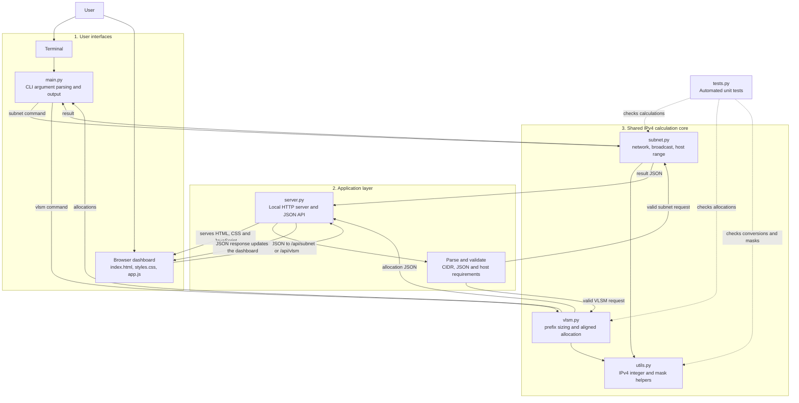

# IPv4 Subnet Calculator and VLSM Allocator

A Python-based IPv4 networking project that makes subnetting calculations
easier to perform, inspect, and explain. Given an address such as
`192.168.1.10/26`, the calculator determines which subnet it belongs to and
shows its network address, broadcast address, usable host range, subnet mask,
wildcard mask, and address capacity.

The project also solves a practical network-design problem with Variable
Length Subnet Masking (VLSM). Provide a parent network and the number of hosts
needed by each team or network segment; the allocator selects appropriately
sized subnet blocks, aligns them to valid boundaries, and reports any
remaining address space. For example, several departments with different
device counts can share one larger network without assigning every department
an equally sized subnet.

Use the same calculation engine in two ways: run commands in a terminal, or
start the local web dashboard to see the network/host bits and VLSM allocations
as visual diagrams and tables. The project is intended as an educational
demonstration of IPv4 addressing, CIDR prefixes, subnet masks, address
boundaries, and subnet allocation. It uses Python's standard library and does
not require third-party packages.

## Features

- Calculate the network, broadcast, subnet mask, wildcard mask, host range,
  usable host count, and total addresses for an IPv4 CIDR.
- Visualize the 32 address bits as network bits and host bits.
- Allocate differently sized subnets from a base network using VLSM.
- View a proportional address-space map, allocation table, and remaining
  address-space summary in the browser.
- Validate IP addresses, prefixes, host requirements, and available capacity.
- Handle `/31` point-to-point and `/32` single-address subnets in the subnet
  calculator.
- Run without third-party Python packages.

## Requirements

- Python 3.10 or later
- A modern web browser for the visual dashboard

## Project architecture

The project has three layers: **two entry points** (CLI and browser), a
**Python application layer** that parses and validates requests, and a
**shared calculation core** that performs the IPv4 math. The browser does not
reimplement subnet calculations: it sends JSON to the local Python server,
which calls the same core modules used by the CLI.

```text
ip-subnet-calculator/
├── main.py              CLI entry point
├── server.py            Local HTTP server and JSON API
├── subnet.py            Single-subnet calculation logic
├── vlsm.py              VLSM sizing and allocation logic
├── utils.py             IPv4 integer and subnet-mask helpers
├── tests.py             Automated unit tests
├── web/
│   ├── index.html       Dashboard structure
│   ├── styles.css       Responsive visual theme
│   └── app.js           Browser interactions and diagrams
└── README.md
```

### System architecture diagram

Follow the arrows to see how a user's input becomes a displayed result. The
solid paths show the subnet/VLSM request flow; the shared core keeps the
calculation behavior consistent for both interfaces.



### What each part does

| Component | Responsibility |
|---|---|
| `web/index.html` | Defines the subnet calculator and VLSM planner forms and result areas. |
| `web/styles.css` | Styles the dashboard, bit visualization, allocation map, and responsive layout. |
| `web/app.js` | Reads form values, calls the JSON API, and updates the page with results. |
| `server.py` | Serves the browser files, accepts API requests, validates request shape, calls the core, and returns JSON or a useful error. |
| `main.py` | Defines terminal commands, parses arguments, and prints core calculation results. |
| `subnet.py` | Calculates subnet details from an IPv4 address and prefix. |
| `vlsm.py` | Sizes host requirements and assigns aligned subnet blocks largest-first. |
| `utils.py` | Converts IPv4 addresses to/from integers and builds prefix masks. |
| `tests.py` | Checks expected results and important error cases using Python's `unittest`. |

### Request lifecycle

**Browser subnet calculation**

1. The user enters an address such as `192.168.1.10/26` and selects
   **Calculate subnet**.
2. `web/app.js` sends the CIDR as JSON to `POST /api/subnet`.
3. `server.py` parses the JSON, validates the IPv4 CIDR, and calls
   `subnet.subnet_info`.
4. `subnet.py` uses `utils.py` to calculate the mask, network, broadcast,
   host range, and address counts.
5. `server.py` returns the result as JSON. `web/app.js` updates the bit strip
   and result cards in the browser.

**Browser VLSM allocation**

1. The user enters a base network and a list of named host requirements.
2. `web/app.js` sends the base CIDR and requirements to `POST /api/vlsm`.
3. `server.py` validates the request and passes it to `vlsm.vlsm_split`.
4. `vlsm.py` sorts requirements largest-first, selects the smallest fitting
   prefix for each, aligns each block, and checks that every allocation fits.
5. The allocation list returns as JSON; `web/app.js` renders the proportional
   address map, remaining space, and allocation table.

The CLI follows the same core path without the browser or HTTP server:
`main.py` parses command-line arguments, calls `subnet.py` or `vlsm.py`, then
prints the returned data. `tests.py` calls the shared core directly, so it
checks the calculation logic independently of either interface.

### Example VLSM allocation diagram

For the example base network `192.168.1.0/24`, the allocation is made from the
lowest address upward. This hierarchy shows the exact address ranges and the
space left over:

```text
192.168.1.0/24  (256 addresses: .0 through .255)
├── LAN-A  192.168.1.0/25    .0   - .127   128 addresses
├── LAN-B  192.168.1.128/26  .128 - .191    64 addresses
├── LAN-C  192.168.1.192/27  .192 - .223    32 addresses
├── WAN-1  192.168.1.224/30  .224 - .227     4 addresses
├── WAN-2  192.168.1.228/30  .228 - .231     4 addresses
└── Free                     .232 - .255    24 addresses
```

The web dashboard renders the same allocation proportionally and shows the
network CIDR, usable host range, required hosts, and usable capacity for each
segment.

| Network | Hosts needed | CIDR | Usable host range | Usable capacity |
|---|---:|---|---|---:|
| LAN-A | 100 | `192.168.1.0/25` | `192.168.1.1`–`192.168.1.126` | 126 |
| LAN-B | 50 | `192.168.1.128/26` | `192.168.1.129`–`192.168.1.190` | 62 |
| LAN-C | 25 | `192.168.1.192/27` | `192.168.1.193`–`192.168.1.222` | 30 |
| WAN-1 | 2 | `192.168.1.224/30` | `192.168.1.225`–`192.168.1.226` | 2 |
| WAN-2 | 2 | `192.168.1.228/30` | `192.168.1.229`–`192.168.1.230` | 2 |

## Run the visual dashboard

Open a terminal in the project folder and start the local server:

```text
python server.py
```

Open **http://127.0.0.1:8000** in your browser. The server binds to the
loopback interface, so the dashboard is available on your own computer.
Press `Ctrl+C` in the terminal to stop it.

### Use the subnet calculator

The dashboard opens with `192.168.1.10/26` as an example. Edit the CIDR input
and select **Calculate subnet**. The bit strip distinguishes network bits from
host bits, and the result cards show network/broadcast addresses, usable range,
mask, wildcard, and address counts.

### Use the VLSM planner

Select **VLSM allocation**, enter a base network, and add or edit subnet names
and required host counts. Select **Allocate subnets** to display the address
map and allocation table. The planner reports invalid requirements and when
the requested blocks do not fit.

## Run the command-line interface

### Calculate one subnet

```text
python main.py subnet 192.168.1.10/26
```

Expected key results:

```text
network:         192.168.1.0
broadcast:       192.168.1.63
first_host:      192.168.1.1
last_host:       192.168.1.62
host_count:      62
total_addresses: 64
```

### Allocate subnets with VLSM

```text
python main.py vlsm 192.168.1.0/24 LAN-A:100 LAN-B:50 LAN-C:25 WAN-1:2 WAN-2:2
```

Expected CIDR allocations:

```text
LAN-A  192.168.1.0/25
LAN-B  192.168.1.128/26
LAN-C  192.168.1.192/27
WAN-1  192.168.1.224/30
WAN-2  192.168.1.228/30
```

Requirements are sorted largest-first to reduce fragmentation. VLSM uses
conventional network and broadcast reservations: a requirement for two usable
hosts gets a `/30` block. `/31` links are supported by the single-subnet
calculator, but are not used by the VLSM allocator.

Get command help with:

```text
python main.py --help
python main.py subnet --help
python main.py vlsm --help
```

## Test the project

Run all unit tests from the project directory:

```text
python -m unittest -v
```

The tests cover IPv4 conversions, mask and prefix boundaries, subnet results,
`/31` and `/32` behavior, VLSM prefix selection, aligned allocations,
insufficient capacity, and invalid requirements.

## Calculation concepts

- **CIDR prefix:** `/n` means the first `n` of the 32 IPv4 bits identify the
  network. The remaining `32 - n` bits identify addresses within it.
- **Network address:** The address with every host bit set to zero.
- **Broadcast address:** The address with every host bit set to one.
- **Subnet mask:** A 32-bit mask with the network bits set to one and host bits
  set to zero. The wildcard mask is its bitwise inverse.
- **Ordinary usable hosts:** `2^(32 - prefix) - 2`, reserving the network and
  broadcast addresses.
- **VLSM block size:** For a requirement of `H` conventional usable hosts,
  choose the smallest power-of-two address block that holds at least `H + 2`
  addresses, then align its network address to that block boundary.
- **Special prefixes:** `/31` has two point-to-point addresses and `/32`
  represents one address in the subnet calculator.

## Suggested project demonstration

1. Start the dashboard with `python server.py` and open
   `http://127.0.0.1:8000`.
2. Explain the `/26` bit strip: 26 network bits and 6 host bits. Show the
   resulting 64 total addresses and 62 usable hosts.
3. Switch to VLSM allocation, explain why the largest host requirement is
   placed first, and run the five-network `/24` example above.
4. Point out the allocated address ranges and 24 addresses left free. Try
   increasing a host requirement until the interface reports insufficient
   address space.
5. Run `python -m unittest -v` to show the automated checks.

## Learning outcomes

After exploring the project, a student should be able to:

- Explain how a CIDR prefix separates network bits from host bits.
- Calculate network and broadcast addresses and determine the usable range.
- Select an appropriately sized subnet for a required number of hosts.
- Explain why VLSM allocations are sorted largest-first and must be aligned.
- Read and validate subnet calculations with automated tests.

## Web API reference

The local dashboard uses these JSON endpoints:

| Method | Path | Request example |
|---|---|---|
| `POST` | `/api/subnet` | `{"cidr":"192.168.1.10/26"}` |
| `POST` | `/api/vlsm` | `{"base_cidr":"192.168.1.0/24","requirements":[{"name":"LAN-A","hosts":100}]}` |

Successful requests return JSON calculation results. Invalid input or
insufficient address space returns HTTP `400` with an `error` message.

## Troubleshooting

- **`python` is not recognized:** Install Python 3.10+ and enable the option to
  add Python to `PATH`, or use the `py` launcher (`py server.py`,
  `py main.py ...`).
- **Port 8000 is already in use:** Stop the other local service using that
  port, then start this project again.
- **The page does not load:** Confirm `server.py` is still running and visit
  `http://127.0.0.1:8000` (not `https`).
- **A VLSM request does not fit:** Reduce host requirements, remove a subnet,
  or choose a larger base network (a smaller base prefix, such as `/23`
  instead of `/24`).
- **Invalid CIDR or host count:** Use an IPv4 CIDR such as `192.168.1.10/26`
  and positive whole-number host requirements.

## Limitations

- IPv4 only; IPv6 is not implemented.
- VLSM reserves network and broadcast addresses for all allocated subnets and
  does not allocate `/31` links.
- The web server is intended for local demonstrations and educational use, not
  as a production internet-facing service.
